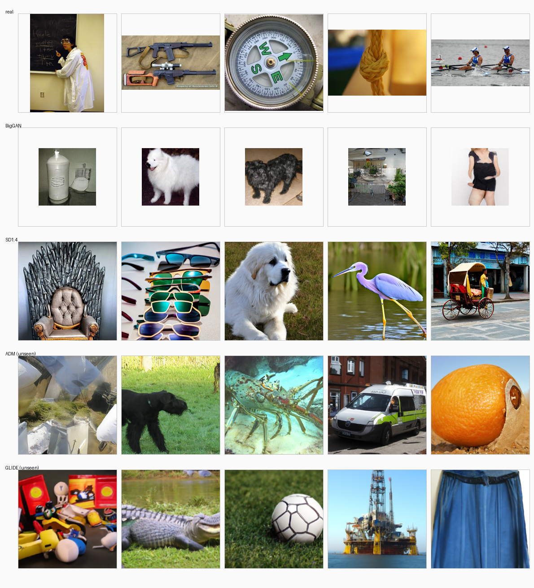

# AI 生成图像检测：跨生成器泛化与变换一致性

> MAIE5421 Computer Vision · Project 6 · 6 人小组课程项目
> 一个 JPEG/PNG 图像分类器：判定 **Real / AI-Generated** 并给出 P(AI)，重点考察**跨生成器泛化**与**对图像变换的鲁棒性**。

---

## 1. 项目要做什么

给定一张图片，模型输出"真实照片"或"AI 生成"的概率。与常见做法不同，本项目不追求单生成器上的最高分，而是回答两个受控问题：

1. **跨生成器**：只在 BigGAN + Stable Diffusion v1.4 上训练，能否识别训练中从未出现过的 ADM 与 GLIDE？
2. **变换一致性**：把预测一致性正则（Jensen–Shannon 散度）迁移到小型预训练检测器上，是否比"只做常规数据增广"更鲁棒？

生成器分配：

| 角色 | 生成器 | 出现在 |
|---|---|---|
| 已见（seen） | BigGAN、Stable Diffusion v1.4 | train / val / test_seen |
| 留出（unseen） | ADM、GLIDE | **仅** test_unseen_ADM / test_unseen_GLIDE |

> 一致性学习本身是已有方法（Temporal Ensembling），本项目的贡献是**系统实现 + 面向任务的训练设计 + 受控评估**；它是否带来提升由实验决定。

## 2. 当前状态

| 模块 | 状态 | 位置 / 负责人 |
|---|---|---|
| 12,000 张数据集（4 生成器 × 5 划分） | ✅ 完成 | `Images/`（FEI） |
| 来源清单 manifest + 偏置审计 + 校验报告 | ✅ 完成（0 error） | `Images/manifest.csv` 等（FEI） |
| 数据读取 / paired-view 变换 / 扰动模块 | 🚧 待实现 | OUYANG |
| ResNet-18 封装 + A/B 训练入口 + pilot | 🚧 待实现 | TONG |
| 一致性损失（C）+ configs + 六次运行调度 | 🚧 待实现 | WANG |
| 评测脚本 / bootstrap / 图表 | 🚧 待实现 | ZHANG |
| CLI + 一键复现 + 环境锁定 | ⏳ 待实现 | ZHUO |
| 6 页 CVPR 报告 + 10 分钟展示 | ⏳ W3 起并行 | FEI 统稿 / ZHUO 主讲 |

> 本仓库目前只包含**数据管线**；训练与评测代码尚未落地。数据集本体（1.87 GB 图像）**不在 git 中**，见 `.gitignore`。

## 3. 数据集（已经可用的部分）

[`Images/README.md`](Images/README.md) · 完整字段与审计：[`docs/dataset-card.md`](docs/dataset-card.md)

| split | 用途 | real | BigGAN | SD v1.4 | ADM | GLIDE | 合计 | 类别数 |
|---|---|---|---|---|---|---|---|---|
| `train` | 训练 A/B/C | 3,000 | 1,500 | 1,500 | — | — | **6,000** | 1,000 |
| `val` | 早停 / 选阈值 | 750 | 375 | 375 | — | — | **1,500** | 375 |
| `test_seen` | 已见生成器测试 | 750 | 375 | 375 | — | — | **1,500** | 375 |
| `test_unseen_ADM` | 留出生成器测试 | 750 | — | — | 750 | — | **1,500** | 750 |
| `test_unseen_GLIDE` | 留出生成器测试 | 750 | — | — | — | 750 | **1,500** | 750 |
| **合计** | | 6,000 | 2,250 | 2,250 | 750 | 750 | **12,000** | |

- **来源**：GenImage [1] → 子集镜像 `naatee/genimage-subset-9`（HF）。图像字节与上游完全一致，未重编码；每一张都能用 `source_image_path` + `source_md5` 回溯。
- **无泄漏**：真实图 6,000 张在五个集合间互不相交；留出生成器不出现在训练/验证/已见测试；全程 `md5` 去重。
- **开发样例**：`Images/fixture/` 100 张（50 real + 25 BigGAN + 25 SD1.4），与正式集零重叠，供数据管线并行开发。
- **重新生成**：`seed = 5421`，类分层抽样，命令见 §7。



## 4. 快速开始

```bash
git clone <repo-url> && cd "Final Project"

# 如需重建数据（约 16 GB 下载，需要 pyarrow），否则跳过：
python tools/dataset/download_shards.py
python tools/dataset/build_dataset.py
python tools/dataset/verify_dataset.py
```

数据是否就绪，用 5 行确认：

```python
import pandas as pd
m = pd.read_csv("Images/manifest.csv")
print(m.groupby(["split", "generator"]).size().unstack(fill_value=0))
print(m.shape)          # (12000, 20)
```

读取方式（**不要**直接用 `ImageFolder` 指到 `Images/`，它会把 split 当类别）：

```python
import pandas as pd
from PIL import Image
from torch.utils.data import Dataset

class GenImageSubset(Dataset):
    def __init__(self, manifest, split, root="Images"):
        self.df = manifest[manifest.split == split].reset_index(drop=True)
        self.root = root
    def __len__(self):
        return len(self.df)
    def __getitem__(self, i):
        r = self.df.iloc[i]
        img = Image.open(f"{self.root}/{r.rel_path}").convert("RGB")
        return img, int(r.label), r.image_id
```

## 5. 实验设计（A / B / C 三条件）

所有条件共用：ImageNet 预训练 **ResNet-18**、224×224 RGB、相同归一化与相同数据划分；
**只训练最后一个残差块 + 二分类头**，更早的层及其归一化统计量冻结。

| 条件 | 目标 | 训练目标 |
|---|---|---|
| **A** | 常规监督基线 | 干净图像上的 BCE |
| **B** | 常规增广基线 | 对 x 与变换视图 T(x) 的 BCE 取平均（等价于 C 中 λ = 0） |
| **C** | 一致性正则 | B 的监督项 + λ·JS(p(x), p(T(x)))，初始 λ = 1 |

$$L = 0.5\left[\mathrm{BCE}(p(x), y) + \mathrm{BCE}(p(T(x)), y)\right] + \lambda \cdot \mathrm{JS}\!\left(p(x), p(T(x))\right)$$

- T 随机取 JPEG 压缩、降采样/缩放或两者兼用，**对两个标签等价施加**；
- 优化：AdamW，lr 1e-4，等效 batch 16，混合精度，最多 8 epoch，按 val AUC 早停（patience 2）；
- 每个条件 2 个共享随机种子 → 共 6 次训练；B/C 共享 batch、视图与更新预算；
- 推理用干净图像，阈值 0.5；只在 val 上选 checkpoint，选型在正式测试前冻结。

> 注意：数据集存在**格式与分辨率偏置**（real=JPEG 尺寸不定，fake=PNG 固定 128/256/512），
> 详见 `Images/bias_audit.json` 与数据集卡 §5。三条件的预处理必须完全一致，并应补一个"消除捷径"的对照实验。

## 6. 评测协议

AI = 正类。报告 **accuracy / precision / recall / F1 / ROC-AUC / 混淆矩阵**。

| 测试集 | 内容 |
|---|---|
| `test_seen` | 已见生成器，干净图像 |
| `test_unseen_ADM` / `test_unseen_GLIDE` | 留出生成器 |
| 扰动 | 在上述基础上分别施加 JPEG q=70 / q=50、0.5× 降采样、高斯模糊 σ=1.0，与干净结果对比 |

- A vs B：常规增广的作用；B vs C：一致性项的消融；
- 两个种子分别报告并给均值；关键差异给**配对图像 bootstrap** 置信区间（不视为完整训练不确定性）；
- 检查假阳性/假阴性，以及内容类别与来源偏置；所有模型选择在最终测试前冻结。

## 7. 仓库结构

```
.
├── Images/                     # 数据集（图像不入 git）
│   ├── train/ val/ test_seen/ test_unseen_ADM/ test_unseen_GLIDE/
│   ├── fixture/                # 100 张开发样例
│   ├── manifest.csv            # 12,000 行来源清单（共享接口）
│   ├── dataset_summary.json  verification.json  bias_audit.json
│   └── preview_contact_sheet.png
├── tools/dataset/              # 数据管线（可复现，seed=5421）
│   ├── hfhttp.py               # HTTP range 读取远程 parquet footer
│   ├── probe_shards.py         # 90 个分片 → 生成器映射
│   ├── download_shards.py      # 下载所需 31 个分片
│   ├── build_dataset.py        # 抽样 + 逐张 md5 校验 + 写出 Images/
│   ├── verify_dataset.py       # 独立校验（12,000 张全部解码/哈希/无泄漏）
│   ├── audit.py                # 偏置审计表
│   └── make_extras.py          # 100 张 fixture + 预览图
├── docs/                       # 提案、指南、分工方案、数据集卡
├── .gitignore
└── README.md
```

随实验推进将新增 `src/datasets/`（OUYANG）、`src/models/` + `src/train.py`（TONG）、
`src/losses/` + `configs/`（WANG）、`eval/`（ZHANG）、`cli/`（ZHUO）、`runs/`（只读产物）。

### 共享接口契约

| 接口 | 字段 | 提供方 | 消费方 |
|---|---|---|---|
| `Images/manifest.csv` | image_id, path, label, generator, class_id/class_name, split, sha256 | FEI | 全部 |
| `configs/*.yaml` | condition, seed, data_manifest, model, freeze_policy, transform, lr, batch, epochs, early_stop | WANG | TONG / ZHANG |
| `runs/<cond>_<seed>/best.pt + config.yaml` | checkpoint 与其配置 | TONG | ZHANG / ZHUO |
| `predictions.csv` | image_id, label, p_ai, generator, transformation, seed, condition | ZHANG | ZHUO / 报告 |
| `metrics.json` | 每个 (cond, seed, test_suite) 的 acc/p/r/f1/auc + CI | ZHANG | 报告 / slides |

## 8. 分工

| 成员 | 主责 | 报告章节 | 备份 |
|---|---|---|---|
| FEI, Wenxiang | 数据获取/划分/去重、manifest、偏置审计、报告统稿 | Data and leakage control | OUYANG |
| OUYANG, Di | 预处理、paired-view 变换、扰动模块、数据 QA | Method（数据与扰动） | FEI |
| TONG, Shaojun | ResNet-18 封装、A/B 训练入口、checkpoint API、pilot | Experimental setup | WANG |
| WANG, Yitian | 一致性损失（C）、configs、六次运行调度、日志台账 | Method（公式与消融） | TONG |
| ZHANG, Yiming | 独立指标、配对 bootstrap、全部图表、错误分析 | Results and analysis | ZHUO |
| ZHUO, Mianjun | CLI、一键复现、失败分析、展示主讲 | Reproducibility / 展示 | ZHANG |

## 9. 里程碑

| 周次 | 日期 | 验收 |
|---|---|---|
| W1 | 11/02 – 11/08 | 冻结接口；数据可用并校验；fixture 冒烟；检查 loss/grad |
| W2 | 11/09 – 11/15 | 冻结数据/训练设置；seed-1 的 A/B/C 跑完并验证 |
| W3 | 11/16 – 11/22 | seed-2 与对照检查；锁定 config/checkpoint |
| W4 | 11/23 – 11/29 | seen/unseen 测试、扰动与错误分析、交叉复现 |
| W5–W6 | 11/30 – 12/13 | 写完各自章节、共同校验报告、彩排展示 |

## 10. 注意事项

1. **格式/分辨率捷径**：real 全 JPEG 且尺寸连续分布，fake 全 PNG 且固定尺寸。仅凭这一点就能拿到虚高准确率；三条件预处理必须一致，并补"重采样到统一尺寸再重编码"的对照实验。
2. **划分来源**：数据集继承镜像的冻结重划分（同源 GenImage 官方 train 分区），与"官方 train/val 目录"不同，报告中需如实说明。
3. **数据不入库**：共享数据请直接拷贝 `Images/` 或用 §4 命令重建；仓库只保留清单与脚本。
4. **尚未完成**：感知近重复检测（pHash / DINO embedding）与 ImageNet 类别先验分布审计。

## 11. 引用

```bibtex
@inproceedings{zhu2023genimage,
  title     = {GenImage: A Million-Scale Benchmark for Detecting AI-Generated Image},
  author    = {Zhu, Mingjian and Chen, Hanting and Yan, Qing and others},
  booktitle = {NeurIPS Datasets and Benchmarks Track},
  year      = {2023}
}
```

- GenImage：https://github.com/GenImage-Dataset/GenImage
- He et al., *Deep Residual Learning for Image Recognition*, CVPR 2016
- Laine & Aila, *Temporal Ensembling for Semi-Supervised Learning*, ICLR 2017

## 12. 许可

代码仅供课程使用；数据沿用上游 **CC BY-NC-SA 4.0**，ImageNet 图像仅限研究用途。
